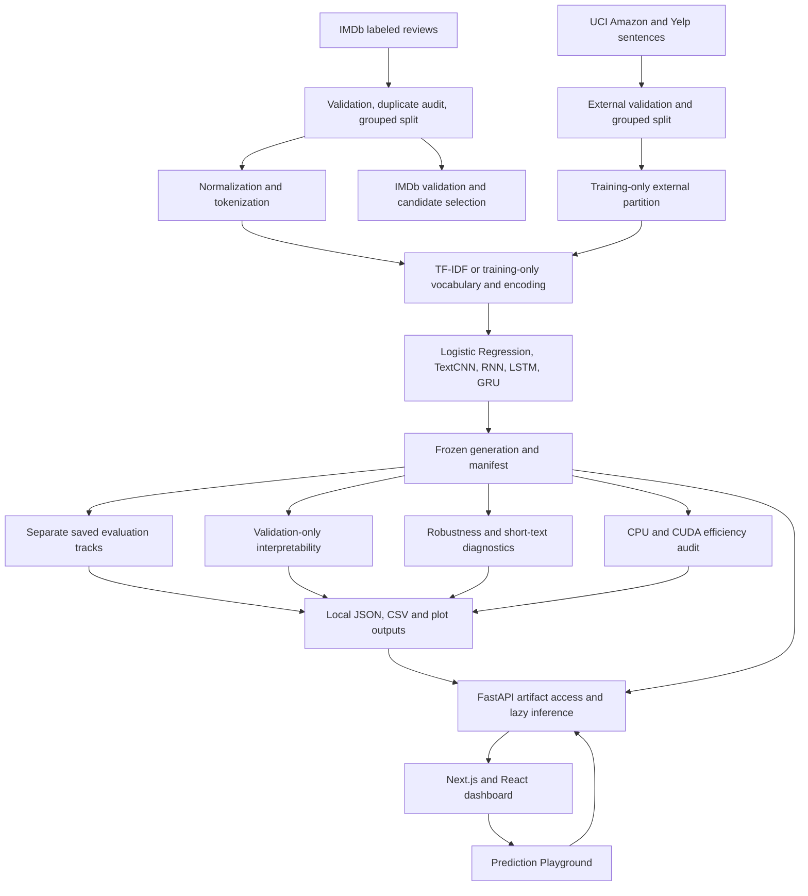

# OpenBench

### A local benchmark for sentiment models, evidence, and trade-offs

## Project overview

OpenBench is a local research application for binary sentiment classification. It compares a classical TF-IDF model with four neural architectures, then examines their saved results across IMDb reviews, supplementary short reviews, robustness challenges, interpretability analyses, and CPU/GPU efficiency measurements.

Sentiment analysis turns subjective language into a reproducible classification task. Comparing model families helps show which patterns a sparse linear model can capture, what convolutional or recurrent text representations add, and how predictive quality changes alongside latency, memory use, and interpretability. OpenBench is more than a classifier: it preserves experiment metadata and predictions, audits dataset boundaries, tests model behavior under text changes, and exposes the frozen local models through an interactive dashboard.

The application runs locally. Its dashboard reads saved research summaries, and the Prediction Playground calls the same local inference code used by the project. No cloud service or hosted inference endpoint is part of the project.

## Research objectives

- Compare classical machine learning with neural models on a shared binary sentiment task.
- Study a text CNN and three recurrent architectures under consistent preprocessing and training interfaces.
- Examine accuracy, precision, recall, F1, confusion matrices, and model disagreements.
- Measure loading time, cold-start and single-review latency, batch throughput, artifact size, parameter count, and memory use.
- Inspect model evidence with architecture-appropriate interpretability methods.
- Evaluate prediction consistency under text perturbations and information loss.
- Measure transfer to short Amazon and Yelp review sentences separately from IMDb review results.
- Demonstrate local inference and research results without training models when the dashboard opens.

## Supported models

All five frozen models use negative label `0` and positive label `1`. The table describes the active generation's saved configuration.

| Model | Architecture and text representation | Why it is included |
|---|---|---|
| Logistic Regression | A scikit-learn pipeline with word-level TF-IDF unigrams and bigrams followed by Logistic Regression. TF-IDF uses sublinear term frequency. | A strong, compact classical baseline with directly inspectable feature contributions. |
| TextCNN | A 100-dimensional embedding feeds parallel one-dimensional convolution branches with widths 3, 4, and 5 and 128 filters per width. Max pooling produces the review representation. | Tests whether local n-gram-like patterns learned from token sequences can model sentiment. |
| Vanilla RNN | A one-layer, unidirectional tanh recurrent network with 100-dimensional embeddings and 128 hidden units. | Provides a basic sequence-state model for comparison with gated recurrent networks. |
| LSTM | A one-layer, unidirectional long short-term memory network with 100-dimensional embeddings and 128 hidden units. | Tests gated memory for retaining useful evidence across a review. |
| GRU | A one-layer, unidirectional gated recurrent network with 100-dimensional embeddings and 100 hidden units. | Compares a gated sequence model with fewer gates than an LSTM. |

The neural models use a 30,000-token vocabulary and sequences capped at 200 tokens in the active generation. Text normalization, vocabulary construction, sequence encoding, and model settings are saved with the artifacts needed for inference. The active models are frozen; opening the dashboard does not retrain or refit them.

## Datasets and experimental methodology

### IMDb Large Movie Review Dataset

The primary task uses the IMDb Large Movie Review Dataset (`aclImdb`), with 25,000 labeled training reviews and 25,000 labeled official test reviews. Each labeled partition is balanced between positive and negative examples. The project validates the expected split layout, labels, readable review text, empty records, and duplicate reviews. The official test partition has **prior project use** and must be treated as a historical descriptive result, not a pristine independent test.

Candidate selection in the active recovery generation used a group-aware 5,000-review validation partition drawn from the labeled IMDb training data. Normalized duplicate reviews were assigned to the same group, and the saved audit reports no normalized-group overlap between the new training and validation partitions. After selection, the active models were refit on all 25,000 labeled IMDb training reviews. The saved validation candidate metrics therefore describe the selected candidates before the final full-data refit; they are not fresh validation scores for the active refitted weights.

Earlier validation experiments used reconstructed stratified splits and reported duplicate-text overlap. Their scores are kept as historical results and are shown separately from recovery-generation validation.

### UCI Sentiment Labelled Sentences

OpenBench also uses the Amazon and Yelp portions of the [UCI Sentiment Labelled Sentences dataset](https://doi.org/10.24432/C57604), dataset 331, licensed under CC BY 4.0. The active generation uses 1,600 Amazon/Yelp training sentences, repeated four times in the training view (6,400 effective rows), alongside the full labeled IMDb training partition. The 200-sentence validation and 200-sentence test partitions are kept separate and were not used for training or model selection. The IMDb sentences bundled in the UCI source were excluded to avoid potential overlap with the sealed IMDb test source.

The external splits are stratified by source domain and label, and grouped by normalized sentence text so duplicate sentences do not cross partitions. Amazon/Yelp results measure transfer to short product and business reviews; they are not directly comparable to IMDb review results.

### Preprocessing and leakage controls

The shared normalizer removes HTML markup, decodes entities, lowercases and normalizes Unicode, and collapses whitespace. It preserves punctuation and negation. The baseline fits TF-IDF on training text only. Neural vocabulary construction and sequence encoding use training partitions only; unseen words map to the unknown token, and sequences are truncated or padded to the configured length.

Dataset validation, normalized duplicate checks, group-aware splits, saved source fingerprints, and aligned prediction records help detect overlap and row-order errors. The external validation and test partitions do not select models. The official IMDb test set is not used for training, preprocessing fit, checkpoint selection, threshold changes, or hyperparameter selection.

## Project architecture



The Python package separates data loading, preprocessing, model architectures, training, evaluation, inference, and experiments. The FastAPI service resolves the active model generation from its pointer and manifest, reads bounded summaries from local outputs, and loads model artifacts only when a prediction is requested. The Next.js interface displays those saved research tracks and local predictions.

## Technology stack

| Area | Technologies used |
|---|---|
| Language and runtime | Python 3.15; Node.js |
| Classical machine learning | scikit-learn |
| Neural models and devices | PyTorch; CUDA when available, with CPU support |
| Data and analysis | pandas, NumPy, Matplotlib, psutil |
| Local API | FastAPI, Pydantic, Uvicorn |
| Interface | Next.js, React, TypeScript, HTML, and CSS |
| Quality checks | pytest, Ruff, ESLint, TypeScript, and frontend Node.js tests |
| Experiment records | Project-local JSON, CSV, and PNG outputs |

No external experiment-tracking service or database is used.

## Evaluation and model comparison

All values below come from saved reports. Accuracy and F1 refer to the positive class where the report specifies a positive-class F1. Each table is a separate dataset or experiment track; values are not combined across tables.

### Active recovery candidate validation — IMDb, 5,000 reviews

These are the selected candidate checkpoints before the active generation's final full-data refit. They were used for model selection and are not an independent test result.

| Model | Accuracy | F1 |
|---|---:|---:|
| Logistic Regression | 89.90% | 89.99% |
| TextCNN | 84.82% | 85.25% |
| Vanilla RNN | 80.98% | 81.59% |
| LSTM | 84.02% | 85.01% |
| GRU | 85.38% | 86.11% |

### Historical Phase 12 validation — IMDb, 5,000 reviews

This table records an earlier model generation and split. It is kept separate from recovery candidate selection.

| Model | Accuracy | F1 |
|---|---:|---:|
| Logistic Regression | 87.72% | 87.90% |
| TextCNN | 84.92% | 85.59% |
| Vanilla RNN | 65.52% | 66.94% |
| LSTM | 83.38% | 83.94% |
| GRU | 86.38% | 86.43% |

### Historical Phase 7 evaluation — IMDb official test, 25,000 reviews

Phase 7 evaluated the original Logistic Regression and TextCNN artifacts. The same saved metrics were reproduced in Phase 13.

| Model | Accuracy | F1 |
|---|---:|---:|
| Logistic Regression | 88.064% | 88.165% |
| TextCNN | 84.536% | 85.201% |

### Historical Phase 13 evaluation — IMDb official test, 25,000 reviews

This later historical generation includes all five models. The official test set had prior use in the project and these results were not used for model selection.

| Model | Accuracy | F1 |
|---|---:|---:|
| Logistic Regression | 88.064% | 88.165% |
| TextCNN | 84.536% | 85.201% |
| Vanilla RNN | 65.632% | 66.783% |
| LSTM | 81.644% | 82.225% |
| GRU | 84.800% | 84.672% |

### Active-generation saved IMDb test metrics — 25,000 reviews

The active generation's test metrics are stored in its generation directory. The Phase 16 audit reused this saved aggregate and did **not** load the IMDb test reviews. Because the official test set had earlier project use, these values remain descriptive rather than a pristine independent estimate.

| Model | Accuracy | F1 |
|---|---:|---:|
| Logistic Regression | 89.960% | 89.970% |
| TextCNN | 83.936% | 83.462% |
| Vanilla RNN | 79.864% | 79.963% |
| LSTM | 82.356% | 82.861% |
| GRU | 81.704% | 80.028% |

### UCI Amazon/Yelp validation — 200 sentences

| Model | Accuracy | F1 |
|---|---:|---:|
| Logistic Regression | 84.50% | 85.02% |
| TextCNN | 81.50% | 83.11% |
| Vanilla RNN | 78.00% | 80.00% |
| LSTM | 76.50% | 79.48% |
| GRU | 83.50% | 84.06% |

### UCI Amazon/Yelp test — 200 sentences

This saved holdout was not used for model selection. It measures short-text transfer on Amazon and Yelp, not IMDb reviews.

| Model | Accuracy | F1 |
|---|---:|---:|
| Logistic Regression | 90.50% | 90.64% |
| TextCNN | 85.50% | 86.26% |
| Vanilla RNN | 79.50% | 79.80% |
| LSTM | 84.50% | 85.58% |
| GRU | 88.00% | 88.46% |

The active recovery validation results describe candidate models before refitting, while the saved active-generation IMDb test metrics describe the refitted models. The historical and active-generation tables are not the same checkpoints. A higher result in one table does not establish that a model is universally better.

## Interpretability

Interpretability analyses use the validation partition and do not load the official test set.

- **Logistic Regression:** Exact feature-coefficient contributions show which TF-IDF terms move a review toward either class.
- **TextCNN:** Convolution filter-window analyses identify token windows that activate pooled features.
- **Vanilla RNN, LSTM, and GRU:** Hidden-state traces show how sequence representations change over token positions. LSTM and GRU gate values are checked against their saved model computations.
- **Token-window occlusion:** Batched unknown-token replacement measures how removing local evidence changes a model score.
- **Cross-model explanations:** Pairwise analyses compare local evidence when models agree or disagree.

These methods help inspect model behavior and identify evidence for review. Occlusion and activation analyses are sensitivity explanations, not causal proof of why a person or model formed a sentiment judgment.

## Robustness analysis

The Phase 15 robustness results keep three tasks separate.

### Automatic label-preserving perturbations

The evaluation generated 5,649 accepted variants from 250 validation reviews across 24 transformation types, including spelling, capitalization, punctuation, whitespace, and word-level edits. The table reports per-review majority results and the share of variant predictions that stayed consistent with the original prediction. Variants are paired to source reviews and are not independent examples.

| Model | Per-review accuracy | F1 | Prediction consistency |
|---|---:|---:|---:|
| Logistic Regression | 83.60% | 84.29% | 99.90% |
| TextCNN | 81.60% | 82.31% | 99.35% |
| Vanilla RNN | 60.00% | 60.94% | 97.47% |
| LSTM | 82.80% | 83.77% | 99.08% |
| GRU | 84.00% | 84.00% | 99.46% |

### Information-loss tests

Prefix/suffix truncation and heuristic non-sentiment sentence ablation were evaluated separately across 1,231 variants. These operations can remove sentiment evidence, so their scores are sensitivity measurements rather than label-preserving robustness scores. The saved reports retain results by transformation type and model.

### Author-created semantic challenge

The separate 200-review challenge is balanced across ten categories, including negation, contrast, mixed sentiment, implicit sentiment, and lexical traps.

| Model | Accuracy | F1 |
|---|---:|---:|
| Logistic Regression | 63.50% | 66.05% |
| TextCNN | 68.00% | 71.17% |
| Vanilla RNN | 60.50% | 67.22% |
| LSTM | 63.50% | 68.94% |
| GRU | 63.50% | 65.07% |

The challenge labels are author-intended and have **not been independently adjudicated**. This small set is diagnostic evidence, not a representative estimate of generalization.

### Fixed short-text diagnostics

On the 12 basic examples, TextCNN and LSTM each made zero errors; Logistic Regression and GRU each made one error; Vanilla RNN made three. Four additional semantic examples are shown separately and are not scored. This hand-selected suite is not an evaluation sample and cannot support a generalization claim.

## Efficiency benchmarking

The Phase 16 benchmark measured model initialization and artifact loading, first-prediction cold-start latency, end-to-end single-review latency, forward-only latency, batch latency and throughput, artifact size, parameter count, process RSS, and CUDA allocated/reserved memory where available. Measurements were made on Windows 11 with Python 3.15.2, PyTorch 2.15.0+cu132, and an NVIDIA GeForce RTX 3050 A Laptop GPU. Logistic Regression is CPU-only. End-to-end single-review timings include saved preprocessing.

| Model | Artifact size (bytes) | Parameters | CPU median review latency | CUDA median review latency | First prediction, CPU / CUDA |
|---|---:|---:|---:|---:|---:|
| Logistic Regression | 2,950,483 | — | 1.958 ms | — | 69.570 ms / — |
| TextCNN | 13,112,174 | 3,154,754 | 2.234 ms | 6.979 ms | 15.888 ms / 572.039 ms |
| Vanilla RNN | 12,610,978 | 3,029,698 | 5.546 ms | 10.627 ms | 9.063 ms / 117.538 ms |
| LSTM | 12,964,280 | 3,118,018 | 1.736 ms | 11.261 ms | 3.368 ms / 11.664 ms |
| GRU | 12,735,786 | 3,060,802 | 11.463 ms | 10.559 ms | 18.028 ms / 14.490 ms |

In this run, LSTM had the fastest CPU single-review median (1.736 ms), TextCNN had the fastest supported CUDA median (6.979 ms), and Logistic Regression reached the highest measured batch throughput (2,612 reviews per second at batch size 128 on CPU). The smallest saved inference artifact was Logistic Regression. Process RSS includes the Python runtime and shared libraries; latency, memory, and throughput depend on hardware and runtime conditions. The audit does not calculate a combined quality/efficiency score.

## Interactive dashboard

The local dashboard has eight pages: Overview, Model comparison, Experiments, Final evaluation, Interpretability, Robustness, Efficiency, and Prediction Playground. Comparison presents one saved dataset or evaluation track at a time. The other research pages preserve source, split, and limitation notes alongside their saved reports and plots.

The Prediction Playground accepts a review and runs it through one selected frozen model or all five. It uses the same local preprocessing and inference pipeline as the project, and reports per-model availability, sentiment, raw class scores, latency, and the device actually used. Models are loaded lazily and cached. CUDA failures are logged and retried on CPU; results identify CPU when fallback occurs. Displayed class scores are uncalibrated model outputs, not calibrated confidence estimates.

## Research findings

- Logistic Regression led the active recovery candidate-validation and saved UCI short-text tracks in this set of runs. Those tracks are distinct, and the validation candidates preceded the final full-data refit.
- The CNN and recurrent models did not consistently outperform the sparse linear baseline on these saved datasets. TextCNN led the author-created semantic challenge F1, but those labels have not been independently reviewed.
- Automatic spelling and formatting changes usually left predictions unchanged in the paired review-level analysis. This consistency does not establish correctness under information loss or semantic changes.
- Short review sentences differ from long IMDb reviews. UCI results, the small diagnostic suite, and live Playground predictions provide complementary views rather than a single generalization score.
- Runtime trade-offs depend on device and workload: the CPU was faster for some single-review measurements, while CUDA supports neural inference and can change batch throughput.
- Coefficient, convolution-window, hidden-state, gate, and occlusion views offer different forms of model evidence and have different interpretive limits.

These findings describe the saved experiments. They are not statistical significance tests and do not establish universal model rankings.

## Limitations and future research

### Current limitations

- The official IMDb test set has prior project use. Its current-generation metrics were saved and reused in the Phase 16 audit; they are not a pristine independent estimate.
- The active recovery validation table reports selected candidate checkpoints before final full-data refitting.
- The UCI evaluation covers short Amazon and Yelp sentences and has only 200 validation and 200 test examples.
- The semantic challenge is small and its author-created labels are not independently adjudicated.
- The 12-example diagnostic set is intentionally small and is not representative.
- The model set is limited to one sparse linear baseline, one CNN, and three unidirectional recurrent networks. Model scores are uncalibrated.
- Results are single saved runs. Efficiency measurements are specific to the recorded machine, software stack, device, and timing protocol.

### Potential future research

A new, untouched external test set, independent review of challenge labels, repeated seeds, probability calibration, additional domains, or transformer comparisons could answer new questions. None of those studies is part of the completed project.

## Project structure

```text
OpenBench/
├── data/robustness/          # Author-created semantic challenge and documentation
├── datasets/                 # Local source datasets; not tracked in project outputs
├── docs/                     # Roadmap and agent/project constraints
├── frontend/
│   ├── src/app/              # Next.js page routes and global styles
│   ├── src/components/       # Dashboard shell, views, and shared primitives
│   ├── src/lib/              # Typed local API client
│   └── tests/                # Frontend API client tests
├── notebooks/                # Reviewable phase experiment walkthroughs
├── outputs/                  # Local model generations and saved experiment evidence
├── src/deeptext/
│   ├── data/                 # IMDb and external dataset loading and validation
│   ├── evaluation/           # Shared metrics and comparison helpers
│   ├── experiments/          # Training, evaluation, robustness, interpretation, audits
│   ├── inference/            # Frozen model prediction interfaces
│   ├── models/               # Logistic Regression, TextCNN, RNN, LSTM, and GRU
│   ├── preprocessing/        # Normalization, vocabulary, and encoding
│   ├── training/             # Trainer, early stopping, and checkpoint management
│   └── dashboard/            # FastAPI, artifact repository, and local inference registry
├── tests/                    # Python unit and integration tests
└── run.py                    # Local API and frontend supervisor
```

## Research conclusion

OpenBench demonstrates an end-to-end local workflow for comparing a classical text classifier with several neural architectures while preserving the evidence needed to inspect their behavior. Its saved experiments show that predictive quality, robustness, interpretability, and efficiency answer different questions. Reporting those results on separate tracks—and making prior test-set use, challenge-label uncertainty, and hardware-specific timing visible—keeps the comparison useful without overstating what one project can establish.
